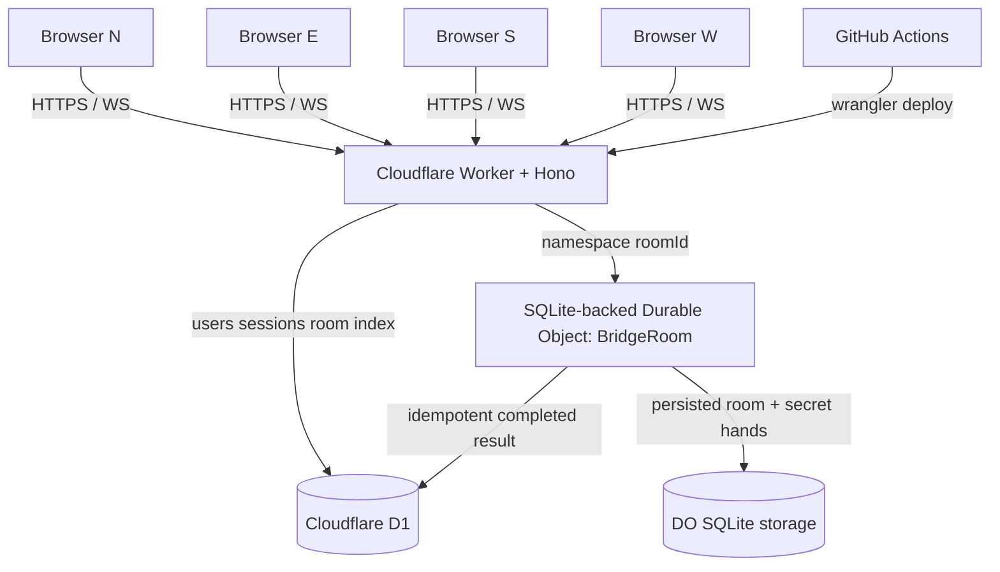

# ARCHITECTURE — Cloudflare-native server-authoritative multiplayer

## 1. Topology



## 2. Runtime responsibilities

**React SPA**: UI/rendering, own-hand view, legal-move hints only, request ID generation, WS connection, playback animation, reconnection. Never source of truth.

**Hono Worker**: `/api` routes, cookie identity/session verification, authorize room joining, map opaque room ID/code to DO, WS upgrade Origin check and secure forwarding, D1 search/index. Absolutely no direct client D1 credentials.

**One `BridgeRoom` Durable Object per room**: seat claims, ready state, private 52-card deck/hands, auction, trick state, current turn, action validation, event version, WS subscriptions, board progress, persist before acknowledgement, snapshots tailored to each seat, and result finalization.

**D1**: users and session hashes, room lookup metadata, match records, completed board results. D1 is not authoritative for live cards or real-time seat locking. Eventual mirrors may be stale but must never authorize card play.

**`packages/game-engine` pure TypeScript**: `createDeck`, `deal`, `validateCall`, `applyCall`, `resolveAuction`, `validateCardPlay`, `applyCard`, `resolveTrick`, `scoreDuplicate`, `getBoardConfiguration`, `projectPublicState`. Explicitly separate domain mutations from IO.

## 3. Suggested repository

```text
contract-bridge-online/
├── apps/web/
│   ├── src/{app,components,features,pages,stores,services,styles}/
│   ├── worker/{index.ts,routes/,auth/,durable-objects/BridgeRoom.ts}/
│   ├── vite.config.ts
│   └── wrangler.jsonc
├── packages/game-engine/src/{types,cards,auction,play,scoring,board,projector}/
├── packages/shared/src/{protocol,schemas}/
├── migrations/
├── docs/
├── .github/workflows/{ci.yml,deploy.yml}
├── package.json
└── README.md
```

The **generated official React/Vite/Workers scaffold controls actual file paths**. Adjust this suggestion to avoid fighting framework conventions; never duplicate Worker entrypoints.

## 4. Durable Object design

- Use stable `roomId` (UUID) to derive DO instance name via `env.BRIDGE_ROOMS.idFromName(roomId)`; roomCode only an index in D1, not an auth secret.
- Use current stable Wrangler declarative **`exports`** config for new SQLite DO classes if supported by generated toolkit; do not combine legacy `migrations` and new DO `exports` for the same class. Check current official docs.
- Accept WebSockets with `ctx.acceptWebSocket(server)` and use `webSocketMessage`, `webSocketClose`, `getWebSockets`, `serializeAttachment` / `deserializeAttachment`. **Do not call `server.accept()`** for hibernating WS.
- Persist authoritative state and last processed request IDs in DO storage. Do not rely on in-memory variables or `setInterval` to keep state/WS alive.
- WS attachment contains a minimal authenticated non-secret session/seat identifier and connection metadata. Validate against current server-side room membership before every action; never include private deck in attachment.
- For each command: parse -> authenticate -> authorize -> validate expectedVersion -> ensure idempotency -> pure engine transition -> **persist state + dedup record together** -> send ack and seat-filtered events. Choose DO storage atomic operations/transactions correctly, and test failure injection.
- On hibernation/restart: reconstruct state from DO storage, recover WS attachments via `ctx.getWebSockets()`, validate connection authorization against persisted member map.
- For each new board: assign board number/vulnerability/dealer, shuffle securely, persist before private snapshots.
- Avoid timers in MVP; no turn timers. Use alarms only for actual scheduled cleanup/retry, with bounded retry and documented lifecycle.

## 5. Projection & no hidden information

Have a dedicated seat-aware projection function **on the server**:

- **Every seat**: public auction, lead/trick cards, scores, turn, contract, public dummy after opening lead, counts of other concealed hands, room presence, stateVersion.
- **Own seat**: own hand at all times after deal.
- **Declarer client**: own hand + public dummy (when revealed), command authority to play from dummy only during dummy turn.
- **Dummy client**: sees own hand as player; loses ability to choose card once dummy revealed (can still view public progress).
- **After board completed**: full recap optional; by default no unnecessary private hand transmission.
- **Do not send complete GameState and strip UI fields on the client**. Server must build outbound payloads using allowlisted projection fields.

## 6. Room life cycle

`WAITING -> DEALING -> BIDDING -> PLAYING -> BOARD_RESULT -> NEXT_BOARD_READY -> ... -> MATCH_COMPLETED -> ARCHIVED`.

- Four ready members required before first board and next board; do not reuse stale ready state.
- If all pass: enter BOARD_RESULT with 0 score (skip PLAYING).
- Seat changes and member replacement are disallowed after first deal in MVP, to preserve integrity. Reconnection of same authenticated identity is allowed.
- Disconnection does not reset board or auto-play cards; show presence and wait in casual mode. Host can end match via clear confirmation/policy.
- Room capacity exactly four distinct authenticated identities; one authoritative seat assignment per identity.

## 7. D1 result commit strategy (DO and D1 are different stores)

There is **no transaction spanning DO storage and D1**. On board completion:

1. Persist final board result and a `pendingResultWrite` record in DO storage atomically.
2. Attempt D1 upsert with unique key `(match_id, board_number)` and stable result id.
3. Mark record synced after confirmed success; otherwise leave pending for retry on subsequent request/alarm.
4. If repeated delivery occurs, duplicate D1 write must have same outcome (idempotent UPSERT with explicit consistency guard).
5. UI derives final score from authoritative DO state; D1 summary can lag temporarily.

## 8. Concurrency and consistency

- Serialized logical transitions in one DO per room; never perform state-changing actions from two distinct services without coordinating through DO.
- Each persisted action increments monotonic `stateVersion` once.
- `requestId` unique per action, scoped by authenticated user/session; store bounded dedup history.
- Wrong version => `STATE_CONFLICT` with current version and re-sync route; duplicates => previous ack, no second transition.
- Separate **boardNumber** and **matchId** from `stateVersion`; not interchangeable.

## 9. Observability

Logs: requestId, roomId (redacted if needed), seat, event type, phase, version, latency, error code. Do not log private hands, secret cookie or auth token, full WS snapshots or CSPRNG state. Failure metrics: connection/reconnect rates, rejected actions, D1 sync backlog. Plan capacity based on real usage and Cloudflare quotas.
